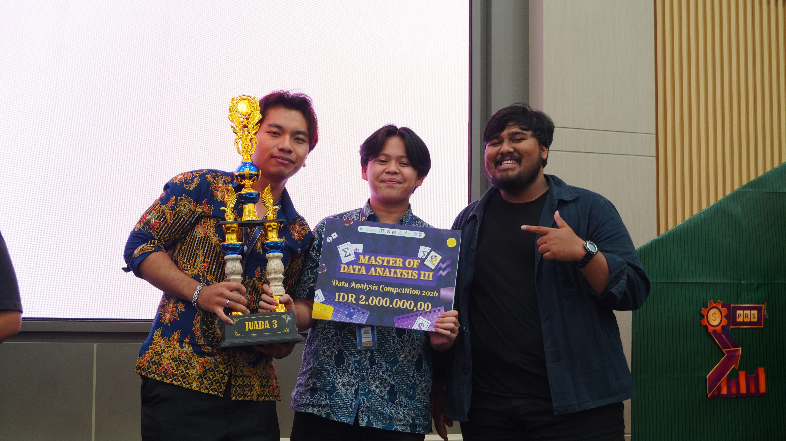
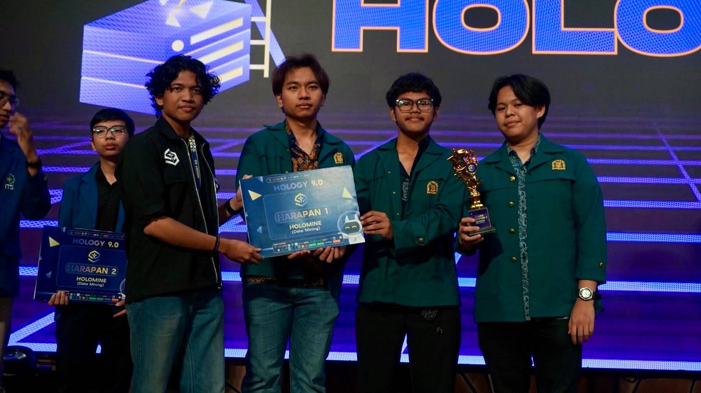

<!-- ============================================================ -->
<!--                      ANIMATED BANNER                         -->
<!-- ============================================================ -->

 

<!-- ============================================================ -->
<!--                      TYPING EFFECT                           -->
<!-- ============================================================ -->

  

<!-- ============================================================ -->
<!--                    PARAMETER BADGES                          -->
<!-- ============================================================ -->

&nbsp;

&nbsp;

  

<!-- ============================================================ -->
<!--                     VISITOR COUNTER                          -->
<!-- ============================================================ -->

 

---

## 👥 Our Team

| 🤖 Member | GitHub |
|:---------:|:------:|
| **Riantama Putra** |  |
| **Athilla Zaidan Zidna Fann** |  |
| **Nicholas Wise Saragih Sumbayak** |  |

 

---

## 🏆 Competition History

| Competition | Category | Task | Result |
|:-----------:|:--------:|:----:|:------:|
| DAC PRS ITS 2026 | Data Analysis Competition | Insurance Churn Prediction | **3rd Place** |
| HOLOGY 9.0 (Final) | Data Mining | Paddy Field Segmentation | **4th Place** |
| HOLOGY 9.0 (Preliminary) | Data Mining | Breast Cancer Classification & Property Price Prediction | **1st Place** |
| IFEST 2026 (Final) | Data Analysis Competition | Water Stress Forecasting | **5th Place** |
| IFEST 2026 (Preliminary) | Data Analysis Competition | Water Stress Prediction | **3rd Place** |

> 📌 ***More competitions will be documented here as our journey continues...***

 

---

## 📸 Team Documentation

<table>
  <tr>
    <td align="center">
      
       
      <b>3rd Place — DAC PRS ITS 2026</b>
    </td>
    <td align="center">
      
       
      <b>1st Honorable Mention — HOLOGY 9.0 Final</b>
    </td>
  </tr>
</table>

 

---

## 💬 Quote of the Day

  

*"Katanya setelah hujan reda, vibes kampus ITB terasa syahdu dan romantis. Ya memang demikian suasananya."*  
— **Pak Rin**

 

<!-- ============================================================ -->
<!--                      FOOTER BANNER                           -->
<!-- ============================================================ -->
